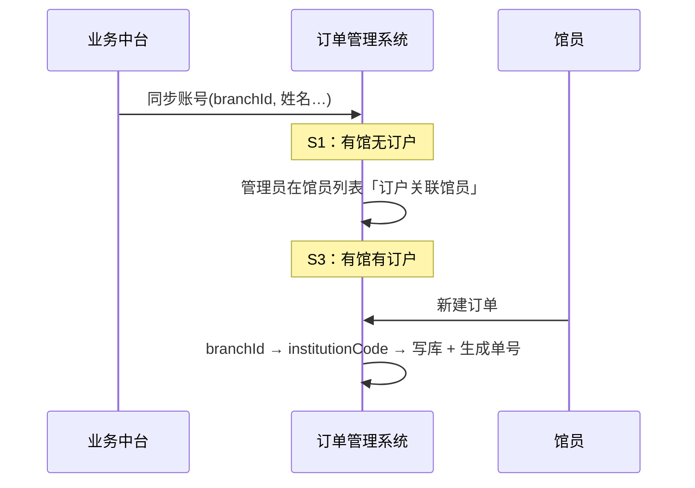

# 多租户机构数据隔离改造

> **已被取代**：请以 [`2026-10-15-institution-data-isolation-revision-design.md`](./2026-10-15-institution-data-isolation-revision-design.md) 为准。本文仅作历史参考；实现与后续计划勿再依据下文未修订段落。

**日期**：2026-09-21  
**状态**：已废弃（由 2026-10-15 修订取代）  
**范围**：订单管理系统全模块（采访业务、订户/馆员、设置、货币）  
**关联**：
- 组织层级 mock（`html/src/modules/subscriber/data/org-hierarchy.js`）
- 馆员上下文（`html/src/modules/subscriber/data/current-librarian.js`）
- 馆员列表 · 订户关联（`html/src/modules/subscriber/views/LibrarianListView.vue`）
- 单号生成（`html/src/modules/order/data/order-create.js`、`html/src/modules/acceptance/data/acceptance-list.js`）
- 馆址/条码规则机构过滤（`2026-09-16-location-level4-pick-design.md`、`2026-09-15-barcode-validation-rule-config-design.md`）

---

## 1. 背景与目标

### 1.1 背景

系统按多租户部署。历史上**租户 code 与 institution_code 一对一**，数据权限隐含在租户维度内。现同一租户下可挂载**多个图书馆机构**，需在同租户内按机构做数据归属与单号前缀区分，同时**不改变既有订户级业务数据权限**。

账号由**业务中台**统一开通（含所在分馆）；**关联订户**仅在订单管理系统 **馆员列表** 中配置。因此存在「有账号、无订户」的正常 onboarding 状态。

### 1.2 目标

1. 业务单据（订单、验收、催缺、结算等）持久化 `institutionId` / `institutionCode`，用于归属、审计与单号前缀。
2. 机构上下文由**登录账号所在分馆**倒推；无分馆时 fallback 至关联订户首个所属机构。
3. **查询过滤以关联订户为准**（订单等模块）；**验收单模块例外**：列表按关联订户所属**机构合集**过滤（§5.4），机构字段不参与订单等其它采访列表读过滤。
4. 单号前缀按机构 `institution_code` 生成；历史 `PG001` 前缀数据**不改号、不迁移**。
5. 按账号四态（S0～S3）统一各菜单模块的读/写策略；未就绪时以空数据为主（§7）。
6. 设置类模块按需展示机构列；采访业务页面**只存不展示**机构字段。

### 1.3 非目标

- 不以机构替代订户做采访业务列表过滤（不做「机构级数据隔离墙」）。
- 不迁移历史单号前缀（`PG001` / `PG001B` / `ysPG001` 等保持原样）。
- 不在本版改造业务中台账号/分馆同步接口（仅约定 OMS 消费字段）。
- 不改造货币等租户级模块的机构维度（除非后续业务另行确认）。

---

## 2. 方案选型

**已选：方案 A — 登录上下文 + 写入时快照**

| 方案 | 说明 | 结论 |
|------|------|------|
| **A** | 统一 `resolveCurrentInstitutionContext()`；创建单据时写入机构并生成单号；读过滤仍走订户 | **采用** |
| B | 查询层强制 institution 过滤（订户 + 机构双重隔离） | 否决（与「订户为主」冲突） |
| C | 仅改单号、不落库 institutionId | 否决（无法满足存储与识别） |

---

## 3. 组织模型

```
租户 (tenant)
 └── 机构 (institution)          ← institution_code 用于单号前缀（如 STLIB；PG001 为历史机构 code）
      └── 馆区 (campus)
           └── 分馆 (branch)     ← 馆员「所在馆」绑定此级（业务中台下发 branchId）
                └── 馆址 (site)
                     └── 馆藏地 (collection)
```

| 概念 | 职责 |
|------|------|
| 租户 | 登录域；全局配置（如货币） |
| 机构 | 业务单据归属；单号前缀；设置类主数据归属 |
| 分馆 | 馆员账号「所在馆」；倒推机构的主路径 |
| 订户 | **业务数据权限边界**（读/写过滤） |

---

## 4. 账号四态

| 状态 | 所在馆（分馆） | 关联订户 | 机构上下文 | 业务就绪 |
|------|---------------|---------|-----------|---------|
| **S0** | 无 | 无 | 不可解析 | 未就绪 |
| **S1** | 有 | 无 | 分馆 → 馆区 → 机构 | 未就绪（缺订户） |
| **S2** | 无 | 有 | 订户 fallback → 机构 | 部分就绪 |
| **S3** | 有 | 有 | 分馆 → 机构 | 完全就绪 |

**前置约束**：订户主数据 **所属机构（`institutionId`）为必填**（见订户管理 PRD 5.9）。已关联订户的账号**必定**可通过 fallback 解析出机构，不存在「有订户但无法确定所属机构」的情况。

### 4.1 机构上下文解析

优先级：

1. 馆员 `branchId` → `getInstitutionIdForBranch(branchId)` → 机构主数据（`source: branch`）。
2. 无 `branchId`：按关联订户顺序取第一个 `institutionId`（`source: fallback`；订户必填机构，故 S2 必可解析）。
3. 既无分馆又无订户（S0/S1）→ 返回 `null`（业务写操作不可用；S1 虽有分馆机构，但无订户仍不进入业务读写）。

### 4.2 账号生命周期

| 阶段 | 负责方 | 配置内容 |
|------|--------|----------|
| 账号开通 | 业务中台 | 账号、姓名、所在分馆（`branchId`）等 |
| 订户授权 | OMS · 馆员列表 | 「订户关联馆员」维护关联订户 |

S1 表示中台已同步分馆、OMS 尚未配订户，属正常 onboarding，非异常账号。

### 4.3 共享基础设施

扩展 `current-librarian.js`（或独立 `institution-context.js`）：

| 函数 | 职责 |
|------|------|
| `getCurrentLibrarianBranchId()` | 读取馆员 `branchId`（中台同步，OMS 只读展示） |
| `getAccountReadiness()` | 返回 `s0` / `s1` / `s2` / `s3` |
| `resolveCurrentInstitutionContext()` | 解析机构上下文；S2/S3 必成功，S0/S1 返回 `null` |
| `assertReadable(moduleKey)` | 读前置；S0/S1 业务模块失败 |
| `assertWritable(actionKey)` | 写前置；S0/S1 失败 |
| `buildInstitutionScopedId(docType, ctx, seq)` | 统一单号生成 |

**馆员主数据扩展**：馆员列表增加 **所在分馆** 列（只读，来自中台；Mock 可手填演示）。`branchId` 不在 OMS 编辑。

---

## 5. 数据模型与单号规则

### 5.1 业务实体机构字段

| 实体 | 字段 | 赋值时机 | 规则 |
|------|------|----------|------|
| 订单 | `institutionId`, `institutionCode` | 创建 | 取创建时 Institution Context |
| 订单行 | 同上 | 创建 | **继承所属订单**，不重新读登录上下文 |
| 验收单 | `institutionId`, `institutionCode` | 创建 | 取创建人 Institution Context；**不设订户字段**，见 §5.4 |
| 催缺单 | 同上 | 创建 | 取创建人 Context；单号继承订单前缀 |
| 换货/退货记录 | 同上 | 创建 | 取操作人 Context |
| 结算申请批次 | 同上 | 创建 | 取操作人 Context |
| 发货单导入任务 | 同上 | 任务创建 | 创建人 Context 快照 |
| 预验收草稿 | 同上 | 写入 | 继承验收单 |

- 编辑已有单据：**不修改**已有 `institutionId` / `institutionCode`。
- 采访业务列表/详情：**不展示**机构列（只存）。

### 5.4 验收单：机构归属与跨订户收货

业务允许**一张验收单在同机构下跨多个订户**收货（例如同机构「采编中心」「少儿中文」订单行进入同一验收单）。验收单头**不设订户字段**；以**机构**为归属维度，以头信息**资源类型**（及语种、采选方式、供应商）为业务匹配维度。

#### 5.4.1 新建时写入机构

创建验收单时落库 `institutionId` / `institutionCode`（与订单相同规则）：

- 取**创建瞬间**的 `resolveCurrentInstitutionContext()`（S3 分馆机构；S2 fallback 订户机构）。
- 进行中状态**不可改**机构（与资源类型等核心字段一致）。
- 弹窗**不增加订户、机构选择**；列表/详情**不展示**机构（只存）。

#### 5.4.2 列表读过滤（验收模块例外）

验收单列表/详情/预验收/发货单任务等**验收域读范围**：

```
验收单对当前馆员可见
  ⇔ acceptance.institutionId ∈ resolveLibrarianInstitutionIds()
```

其中 `resolveLibrarianInstitutionIds()` = 当前馆员**关联订户**的所属机构 ID 合集（去重保序）。馆址 / 条码规则在 S2/S3 用此合集；**S1** 改用所在分馆机构（§8.6.1–§8.6.2，`resolveInstitutionScopeIds()`）。**订单导入模板**为租户级全局，不参与机构过滤（§8.6.3）。

- **不按**验收单订户过滤（无此字段）。
- **不按**创建人账号推导。
- 检索区「资源类型」等为**用户主动筛选**，非权限硬过滤；权限仅卡机构合集。

馆员关联订户分属多机构时，可见**多机构**验收单（各机构内可跨订户）。

#### 5.4.3 订单行匹配（预验收 / 逐条收货 / 发货单导入）

在现有「资源类型、语种、采选方式、供应商」一致校验基础上，增加：

```
订单行可匹配
  ⇔ 订单.subscriber ∈ 当前馆员关联订户
 AND 订户.institutionId === acceptance.institutionId
 AND 头信息维度与验收单一致（type / lang / method / supplier）
```

- **允许**同一验收单下明细来自**多个订户**，只要同属 `acceptance.institutionId`。
- **禁止**跨机构订单行进入验收单（即使馆员关联了多个机构的订户）。

机构一致性判定：优先 `订单.institutionId`（若已落库）；否则 `订户.institutionId`。

#### 5.4.4 与订单模块权限的差异

| 维度 | 订单 / 订单行 | 验收单 |
|------|--------------|--------|
| 列表读过滤 | 关联**订户** | 关联订户 → **机构合集** |
| 单据归属字段 | 订户 + 机构 | **仅机构**（无订户） |
| 跨订户 | 否 | **同机构内允许** |

#### 5.4.5 历史数据迁移（仅迁移）

存量验收单无 `institutionId` 时：

1. 有明细：取明细关联订单行机构；唯一则写入；多个机构则按**明细行数最多**的机构写入。
2. 无明细：从验收单号前缀映射（如 `ysPG001` → `PG001` 机构）或创建人当时 Institution Context 快照补写。

迁移后列表过滤走 §5.4.2，不做运行时明细反查。

### 5.2 单号生成规则

| 单据 | 新规则 | 流水维度 | 历史 |
|------|--------|----------|------|
| 订单号 | `{code}B{yyyyMMdd}{3位}` | tenant + institutionCode + date | `PG001B...` 保留 |
| 订单行号 | `{orderId}-{n}` | 继承订单 | 不变 |
| 验收单号 | `ys{code}{yyyyMMdd}{3位}` | tenant + institutionCode + date | `ysPG001...` 保留 |
| 催缺单号 | `cq{orderId去B}{5位}` | 继承订单前缀 | 不变 |
| 结算单号 | 沿用现有结构，前缀段换 `{code}` | tenant + institutionCode + date | 存量保留 |

- 流水计数器 Key：`{tenantId}:{institutionCode}:{docType}:{yyyyMMdd}`。
- `PG001` 视为某历史机构的 `institution_code`；新机构使用各自 code（如 `STLIB`、`BJCL`）。
- 正式环境建议**后端生成**单号；前端 Mock 本地模拟计数器。

### 5.3 历史数据

- 前缀为 `PG001` / `PG001B` / `ysPG001` / `cqPG001...` 的记录：**不改号**。
- 可选补写 `institutionId`：前缀映射表 `{ "PG001": "inst-legacy-1" }` 或单号解析。
- 无 `institutionId` 的历史行：查询不受影响（订户过滤）；统计/报表按映射表归类。

---

## 6. 数据权限原则

| 模块类型 | 读过滤 | 写过滤 | 机构字段作用 |
|----------|--------|--------|-------------|
| **采访业务（订单等）** | 关联订户范围 | 关联订户（S2/S3）；机构上下文 S2/S3 必可解析 | 归属存储、单号前缀 |
| **采访业务（验收单）** | 关联订户 → **机构合集** | 同左；新建写入机构 | 机构归属；同机构跨订户收货 |
| **馆址 / 条码规则 / 条码号供应商** | **分态**：S1 **所在分馆 → 机构**；S2/S3 关联订户 → **机构合集**；S0 无 | 同读范围 + 角色 | 列表识别、配置归属 |
| **设置（机构敏感·其它）** | 关联订户 → **所属机构合集** | 同上；写入 `institutionId` 须在合集内 | 列表识别、配置归属 |
| **设置（租户级）** | 租户全局 | 角色权限 | 无 |
| **订单导入模板** | **租户内全量** | 角色权限 | 「关联订户」为业务标注，**不**参与列表权限过滤 |
| **订户列表** | **分态**：S1 本机构全部订户（维护用）；**S2/S3 仅关联订户**；S0 无 | 同读范围 + 角色维护权限 | 订户主数据含机构 |
| **馆员列表** | 角色权限内 | 订户关联馆员等（按角色） | 馆员与关联关系 |
| **货币** | 租户全局 | 角色权限 | 无 |

**明确不做**：订单等模块按机构过滤列表（如「仅看本机构订单」）。**验收单列表除外**（§5.4.2）。

---

## 7. 空态原则

S0/S1 业务阻断、S0 机构敏感设置无数据时：**空列表 / 空表格 / 空页面**，**不展示**固定提示文案、Banner 或跳转引导。权限逻辑不变，仅 UI 保持空白即可。

---

## 8. 分模块读写策略（菜单级）

列说明：

- **可读**：是否可加载该模块业务/配置数据。
- **可写**：是否可执行新建、编辑、删除、导入、处置等变更操作。
- **数据权限范围**：实际过滤口径。

### 8.1 订单管理

#### 8.1.1 非连续出版物订单 `/orders`

| 状态 | 可读 | 可写 | 数据权限范围 |
|------|------|------|-------------|
| S0 | 否 | 否 | 无 |
| S1 | 否 | 否 | 无 |
| S2 | 是 | 是 | 仅关联订户的订单/订单行 |
| S3 | 是 | 是 | 仅关联订户 |

#### 8.1.2 书目查询 `/bib-query`

| 状态 | 可读 | 可写 | 数据权限范围 |
|------|------|------|-------------|
| S0 | 书目/Z3950/新建书目：**是**；关联订单行：**否** | 否 | 书目：租户内检索；订单：**无** |
| S1 | 书目检索：**是**；关联订单行：**否** | 否 | 书目：租户内；订单：**无** |
| S2 | 是 | 是 | 书目：租户内；订单相关：**仅关联订户** |
| S3 | 是 | 是 | 同上 |

### 8.2 采访验收

#### 8.2.1 验收单管理 `/acceptance`（含预验收、发货单导入任务）

| 状态 | 可读 | 可写 | 数据权限范围 |
|------|------|------|-------------|
| S0 | 否 | 否 | 无 |
| S1 | 否 | 否 | 无 |
| S2 | 是 | 是 | 关联订户所属**机构合集**内验收单；同机构可跨订户 |
| S3 | 是 | 是 | 同上 |

#### 8.2.2 逐条收货 `/receive`

| 状态 | 可读 | 可写 | 数据权限范围 |
|------|------|------|-------------|
| S0 | 否 | 否 | 无 |
| S1 | 否 | 否 | 无 |
| S2 | 是 | 是 | 当前工作验收单（机构在合集内）+ **同机构**且关联订户下的可收订单行 |
| S3 | 是 | 是 | 同上 |

#### 8.2.3 批量验收 `/batch-acceptance`

| 状态 | 可读 | 可写 | 数据权限范围 |
|------|------|------|-------------|
| S0 | 否 | 否 | 无 |
| S1 | 否 | 否 | 无 |
| S2 | 是 | 是 | 机构合集内验收单；匹配规则同 §5.4.3 |
| S3 | 是 | 是 | 同上 |

#### 8.2.4 换货管理 `/exchange`

| 状态 | 可读 | 可写 | 数据权限范围 |
|------|------|------|-------------|
| S0 | 否 | 否 | 无 |
| S1 | 否 | 否 | 无 |
| S2 | 是 | 是 | 仅关联订户换货记录 |
| S3 | 是 | 是 | 仅关联订户 |

#### 8.2.5 退货管理 `/return`

| 状态 | 可读 | 可写 | 数据权限范围 |
|------|------|------|-------------|
| S0 | 否 | 否 | 无 |
| S1 | 否 | 否 | 无 |
| S2 | 是 | 是 | 仅关联订户 |
| S3 | 是 | 是 | 仅关联订户 |

#### 8.2.6 催缺管理 `/shortage`

| 状态 | 可读 | 可写 | 数据权限范围 |
|------|------|------|-------------|
| S0 | 否 | 否 | 无 |
| S1 | 否 | 否 | 无 |
| S2 | 是 | 是 | 仅关联订户催缺单 |
| S3 | 是 | 是 | 仅关联订户 |

### 8.3 采访结算

#### 8.3.1 待结算 `/pending-settlement`

| 状态 | 可读 | 可写 | 数据权限范围 |
|------|------|------|-------------|
| S0 | 否 | 否 | 无 |
| S1 | 否 | 否 | 无 |
| S2 | 是 | 是 | 仅关联订户待结算数据 |
| S3 | 是 | 是 | 仅关联订户 |

#### 8.3.2 已结算 `/settled`

| 状态 | 可读 | 可写 | 数据权限范围 |
|------|------|------|-------------|
| S0 | 否 | 否 | 无 |
| S1 | 否 | 否 | 无 |
| S2 | 是 | 是 | 仅关联订户已结算数据 |
| S3 | 是 | 是 | 仅关联订户 |

#### 8.3.3 结算失败处理 `/settlement-fail`

| 状态 | 可读 | 可写 | 数据权限范围 |
|------|------|------|-------------|
| S0 | 否 | 否 | 无 |
| S1 | 否 | 否 | 无 |
| S2 | 是 | 是 | 仅关联订户 |
| S3 | 是 | 是 | 仅关联订户 |

### 8.4 订户管理（配置通道）

订户/馆员模块**不受 S0/S1 业务空态阻断**（仍可进入页面做配置），但**订户列表数据范围**按账号四态与机构约束，**非**「租户内全量订户」。

#### 8.4.1 订户列表 `/subscribers`

**列表过滤口径**（订户列表专用，两种模式）：

| 状态 | 过滤模式 | 规则 |
|------|----------|------|
| **S0** | — | 无数据 |
| **S1** | **机构范围**（维护口径） | `subscriber.institutionId === 所在分馆 → 机构` |
| **S2** | **关联订户** | `subscriber` ∈ `getCurrentLibrarianAssociatedSubscribers()` |
| **S3** | **关联订户**（与 S2 同口径） | 同 S2，**不**因已有所在分馆而扩大为机构下全量订户 |

再与角色权限求交（若角色另有范围则取交集）。

| 状态 | 可读 | 可写 | 数据权限范围 |
|------|------|------|-------------|
| **S0** | 否（空列表） | 否 | 无 |
| **S1** | 是 | 是（按角色） | **所在分馆对应机构下**的全部订户（机构管理员维护） |
| **S2** | 是 | 是（按角色） | **仅当前账号关联订户** |
| **S3** | 是 | 是（按角色） | **仅当前账号关联订户**（与 S2、订单等模块订户口径一致） |

**可写（按角色）**：

- **S1**：具备订户维护权限时，可在**本机构范围**内新增/编辑/启停/删除；新建订户 `institutionId` 须为所在分馆机构。
- **S2 / S3**：可在**关联订户**范围内查看/编辑（是否允许编辑由角色决定）；**不可**新建机构级订户、不可见未关联订户。

> **S1**：机构管理员专用视角——中台已配分馆、账号尚未（或不必）关联订户，负责全机构订户主数据维护与馆员关联。  
> **S2 / S3**：采访馆员视角——订户列表与业务模块一致，**只看自己关联的订户**；S3 相比 S2 仅多「已有所在分馆、机构上下文来自分馆」。

#### 8.4.2 馆员列表 `/librarians`

| 状态 | 可读 | 可写 | 数据权限范围 |
|------|------|------|-------------|
| S0～S3 | 是 | 见下表「订户关联馆员」 | 角色权限内馆员及关联关系 |

- 馆员列表增加 **所在分馆** 只读列（中台 `branchId` 展示）。
- **「订户关联馆员」与订户列表可见范围分离**：弹窗内「订户名称」下拉使用 **`resolveAssociateSubscriberCandidates(操作者)`**，**不**等于操作者当前在订户列表能看到的行。

**`resolveAssociateSubscriberCandidates(操作者)`**（维护权限 + 操作者四态）：

| 操作者状态 | 关联弹窗·订户候选池 |
|------------|---------------------|
| **S0** | **空**；「订户关联馆员」**禁用** |
| **S1** | 所在分馆 → 机构下、状态「使用中」的订户（与订户列表 S1 机构口径一致） |
| **S2 / S3** | **禁用**关联入口（候选池不扩大）；由 **S1 管理员**代操作 |

提交后更新目标馆员账号的关联订户，目标账号 **S0→S2**、**S1→S3**。

#### 8.4.3 Onboarding：S0 如何完成订户关联

**矛盾**：S0 订户列表为空，无法在本页选订户；关联又必须在馆员列表完成。

**结论**：S0 账号**不能自举**，须由 **S1 机构管理员**（中台已配置所在分馆 + 订户/馆员维护权限，**无需**管理员自身已关联订户）执行配置。

推荐顺序：

```
1. 业务中台：为【管理员账号】下发所在分馆（branchId）  →  管理员为 S1
2. 订户列表 / 馆址 / 条码规则 / 条码号供应商（S1 管理员）：在本机构下维护相关主数据
3. 馆员列表（S1 管理员）：「订户关联馆员」→ 为目标馆员勾选订户
4. 目标馆员：S0→S2；若中台亦为其配置分馆 → S1→S3
5. 采访馆员（S2/S3）：订户列表仅见关联订户；业务模块可用
```

| 角色 | 典型状态 | 能做什么 |
|------|----------|----------|
| **机构管理员** | **S1**（有分馆、可不关联订户） | 本机构全部订户维护、馆员关联 |
| **采访馆员** | **S2 或 S3** | 订户列表仅关联订户；**不可**做馆员关联 |
| **待启用馆员** | S0 | 等待；采访业务不可用 |

**实现注意**：`LibrarianListView` 的 `subscriberOptions` 不得再使用全量 `activeSubscriberOptions`；改为 `resolveAssociateSubscriberCandidates()`。

### 8.5 货币管理

#### 8.5.1 货币信息 `/currency`

| 状态 | 可读 | 可写 | 数据权限范围 |
|------|------|------|-------------|
| S0～S3 | 是 | 是（按角色） | 租户级全局，与订户/机构无关 |

### 8.6 设置

机构敏感设置分两类：

1. **馆址 / 条码规则 / 条码号供应商**（§8.6.1–§8.6.2、§8.6.7）：onboarding 配置通道，**S1 按所在分馆 → 机构**；S2/S3 按关联订户机构合集。
2. **租户级设置**（§8.6.3 导入模板及 §8.6.5–§8.6.6 等）：**S0～S3 按角色**，不按机构/订户四态过滤。
3. **其它机构敏感项**（如 MARC 映射，待定）：默认 **S1 不可读**；S2/S3 按机构合集或租户级（见各小节）。

**共享机构范围函数** `resolveInstitutionScopeIds()`：

| 状态 | 返回值 |
|------|--------|
| S0 | `[]` |
| S1 | `[getInstitutionIdForBranch(branchId)]` |
| S2/S3 | `resolveLibrarianInstitutionIds()` |

#### 8.6.1 馆址管理 `/locations`

**列表过滤口径**（与 §8.6.2 共用 `resolveInstitutionScopeIds()`）：

| 状态 | 过滤模式 | 规则 |
|------|----------|------|
| **S0** | — | 无数据 |
| **S1** | **分馆机构**（维护口径） | 馆址/分馆/馆藏地所属 `institutionId === 所在分馆 → 机构` |
| **S2** | **机构合集** | 关联订户 → `resolveLibrarianInstitutionIds()` 合集内 |
| **S3** | **机构合集** | 同 S2 |

| 状态 | 可读 | 可写 | 数据权限范围 |
|------|------|------|-------------|
| S0 | 否 | 否 | 无 |
| **S1** | **是** | **是（按角色）** | **所在分馆对应机构下**的馆址/分馆/馆藏地（与订户列表 S1 机构口径一致） |
| S2 | 是 | 是 | 关联订户所属机构合集内 |
| S3 | 是 | 是 | 机构合集内 |

- 新建/编辑馆址时，S1 写入 `institutionId` 须为所在分馆机构；S2/S3 须在机构合集内。
- 馆址列表已有机构编码/名称列；分馆/馆藏地列表本版不加机构列（沿用 `2026-09-16` 规格）。

#### 8.6.2 条码校验规则 `/barcode-rule`

**列表过滤口径**（与 §8.6.1 共用 `resolveInstitutionScopeIds()`）：

| 状态 | 过滤模式 | 规则 |
|------|----------|------|
| **S0** | — | 无数据 |
| **S1** | **分馆机构** | `rule.institutionId ∈ resolveInstitutionScopeIds()`（即本机构） |
| **S2/S3** | **机构合集** | 同上（合集内） |

| 状态 | 可读 | 可写 | 数据权限范围 |
|------|------|------|-------------|
| S0 | 否 | 否 | 无 |
| **S1** | **是** | **是（按角色）** | **所在分馆对应机构下**的条码校验规则 |
| S2 | 是 | 是 | 机构合集内规则 |
| S3 | 是 | 是 | 机构合集内 |

- 新建/编辑规则时，S1 写入 `institutionId` 须为所在分馆机构；S2/S3 须在机构合集内。

#### 8.6.3 订单导入模板 `/import-template`

**租户级全局**：与货币信息等一致，**不受 S0～S3 四态与机构/订户范围约束**；列表与订单导入选用均为租户内全量模板（按角色读写）。

| 状态 | 可读 | 可写 | 数据权限范围 |
|------|------|------|-------------|
| S0～S3 | 是 | 是（按角色） | **租户内全部**导入模板 |

- **移除**现网 `filterImportTemplatesForLibrarian` / `isImportTemplateVisibleToLibrarian` 的**权限过滤**（配置页与业务选用均不再按关联订户隐藏模板）。
- 模板「关联订户」字段保留，仅作业务标注或导入默认口径，**不**作为可见性条件。
- 检索区可按资源类型、语种、订户名称等**用户主动筛选**，非权限硬过滤。

#### 8.6.4 订单与 MARC 类型映射 `/marc-mapping`

| 状态 | 可读 | 可写 | 数据权限范围 |
|------|------|------|-------------|
| S0/S1 | 否* | 否 | 无 |
| S2 | 是* | 是* | **待业务确认**：机构合集内或租户级共享 |
| S3 | 是 | 是 | 同上 |

\* 若最终定为租户级共享，则 S0/S1 也可读，写仍按角色。

#### 8.6.5 退换撤订原因参数 `/reason-params`

| 状态 | 可读 | 可写 | 数据权限范围 |
|------|------|------|-------------|
| S0～S3 | 是 | 是（按角色） | **租户级**（默认；若后续改机构级再调整） |

#### 8.6.6 催缺配置 `/shortage-config`

| 状态 | 可读 | 可写 | 数据权限范围 |
|------|------|------|-------------|
| S0～S3 | 是 | 是（按角色） | **租户级**（默认；待定） |

#### 8.6.7 条码号供应商代码 `/barcode-supplier`

**列表过滤口径**（与 §8.6.1 馆址管理相同，共用 `resolveInstitutionScopeIds()`）：

| 状态 | 过滤模式 | 规则 |
|------|----------|------|
| **S0** | — | 无数据 |
| **S1** | **分馆机构** | `row.institutionId ∈ resolveInstitutionScopeIds()`（即本机构） |
| **S2/S3** | **机构合集** | 同上（合集内） |

| 状态 | 可读 | 可写 | 数据权限范围 |
|------|------|------|-------------|
| S0 | 否 | 否 | 无 |
| **S1** | **是** | **是（按角色）** | **所在分馆对应机构下**的条码号供应商代码 |
| S2 | 是 | 是 | 机构合集内 |
| S3 | 是 | 是 | 机构合集内 |

- 数据层增加 `institutionId`（及列表可选展示所属机构）；新建/编辑时 S1 写入须为所在分馆机构，S2/S3 须在机构合集内。
- 条码校验规则中「馆配商代码」段引用本模块数据时，仍须在**同一机构**范围内选取（与规则 `institutionId` 一致）。

---

## 9. 读写策略汇总

### 9.1 读策略

```
if (模块 ∈ 采访业务 · 验收域) {
  if (状态 ∈ {S0, S1}) → 空
  else                 → acceptance.institutionId ∈ 关联订户机构合集
}
if (模块 ∈ 采访业务 · 其它) {
  if (状态 ∈ {S0, S1}) → 空数据（书目查询纯检索除外）
  else                 → 按关联订户过滤
}
if (模块 ∈ {馆址管理, 条码校验规则, 条码号供应商代码}) {
  if (状态 = S0) → 空
  if (状态 = S1) → institutionId ∈ resolveInstitutionScopeIds()（分馆机构）
  if (状态 ∈ {S2, S3}) → institutionId ∈ 关联订户机构合集
}
if (模块 ∈ 设置·机构敏感 · 其它) {
  if (状态 ∈ {S0, S1}) → 空
  if (状态 ∈ {S2, S3}) → 关联订户 → 机构合集
}
if (模块 = 订户列表) {
  if (状态 = S0) → 空
  if (状态 = S1) → subscriber.institutionId = 所在分馆机构
  if (状态 ∈ {S2, S3}) → subscriber ∈ 当前账号关联订户
}
if (模块 = 馆员列表)   → 角色权限（不受 S0/S1 业务空态阻断）
if (模块 ∈ 租户级设置/货币/订单导入模板) → 角色权限（租户内全量）
```

### 9.2 写策略

```
if (状态 ∈ {S0, S1})     → 阻断（采访业务）
if (状态 = S2)           → 允许；institution source=fallback；单号用 fallback code
if (状态 = S3)           → 允许；institution source=branch；单号用 branch 机构 code
```

### 9.3 四态差异速查

| 维度 | S0 | S1 | S2 | S3 |
|------|----|----|----|-----|
| 机构上下文 | 无 | 有（分馆） | 有（订户 fallback） | 有（分馆） |
| 采访业务·读 | 否 | 否 | 是 | 是 |
| 采访业务·写 | 否 | 否 | 是 | 是 |
| 馆址 / 条码 / 条码供应商·读 | 否 | **是** | 是 | 是 |
| 订单导入模板·读 | 是 | 是 | 是 | 是 |
| 设置·读（机构敏感·其它） | 否 | 否 | 是 | 是 |
| 配置通道 | 馆员/馆址/条码/条码供应商/订户 | 同上 | 正常 | 正常 |

---

## 10. 接口约定（正式环境）

### 10.1 登录上下文

```
GET /api/session/context
```

```json
{
  "account": "STECZB42",
  "name": "首图采编赵玉萍",
  "branchId": "branch-6",
  "branchCode": "HWQ-Main",
  "institutionId": "inst-1",
  "institutionCode": "STLIB",
  "associatedSubscribers": ["采编中心", "视听中心"]
}
```

- `branchId` / 机构：业务中台下发。
- `associatedSubscribers`：OMS 馆员列表维护。
- 前端 Mock：合并 `librarianRows` + `org-hierarchy`。

### 10.2 写接口

请求携带（或由后端从 session 校验）：

```json
{ "institutionId": "inst-1", "institutionCode": "STLIB" }
```

- 后端校验与 session 解析结果一致，防篡改。
- 列表 API **不**以 institution 替代订户过滤。

### 10.3 单号生成

- 建议后端生成；流水按 `{tenantId}:{institutionCode}:{docType}:{yyyyMMdd}` 递增。

---

## 11. 实现落点

| 能力 | 位置 |
|------|------|
| 四态判定、机构上下文 | `current-librarian.js` 或 `institution-context.js` |
| 单号生成 | `order-create.js`、`acceptance-list.js`、`shortage-generate.js` 等 |
| 写操作前置校验 | 各 store action / 模块入口 |
| 空态 | 各 View 空列表即可；**不**新增统一空态组件 |
| 馆员所在分馆列 | `LibrarianListView.vue`、`librarian-manage.js` |
| 订户列表过滤 / 关联候选池 | `resolveSubscriberListScope()`、`resolveAssociateSubscriberCandidates()`（二者分离） |
| 机构范围（馆址/条码/条码供应商） | `resolveInstitutionScopeIds()`；条码供应商 mock 补 `institutionId` |
| 导入模板 | 租户全量；删除订户权限过滤，保留检索筛选 |
| 业务实体字段 | orders、acceptance、shortage、settlement 等 data/store |
| PRD 数据权限节 | `docs/prd.md` 各模块 §x.x.6 同步 |

### 11.1 验收单改造要点

- 数据层增加 `institutionId` / `institutionCode`；新建时 `requireInstitutionContext()`；Mock 存量按 §5.4.5 补写。
- `buildNewAcceptanceId` 传入 `institutionCode`。
- 列表 / 任务列表：`filterAcceptanceRows` 按 `resolveLibrarianInstitutionIds()` 过滤。
- 预验收 / 逐条收货 / 发货单导入：订单行匹配增加**同机构**校验（§5.4.3）；**不**限制单一订户。

---

## 12. 流程示意



---

## 13. 待定项

| 项 | 说明 | 默认 |
|----|------|------|
| MARC 映射机构维度 | 机构合集 vs 租户共享 | 租户共享 |
| 原因参数 / 催缺配置 | 是否机构级 | 租户级 |
| 导入模板机构列 | 租户级下是否展示机构列 | 非必须；关联订户为业务标注 |
| 历史数据 institutionId 补写 | 是否批量脚本 | 可选，不改号 |

---

## 14. 测试要点

1. S0/S1/S2/S3 四态下，各菜单模块读/写符合 §8；未就绪时为空数据，无固定提示文案。
2. S1 账号：采访业务空列表；馆员列表可关联订户后变为 S3（或 S2，视是否已有分馆）。
3. S3 新建订单/验收单：`institutionCode` 来自分馆机构，单号前缀正确。
4. S2 新建：fallback 至订户所属机构，单号前缀正确。
5. 关联订户均含必填 `institutionId`；S2 不存在机构解析失败。
6. 历史 `PG001` 数据：不改号、可查（订户范围内）。
7. 跨机构同租户：订户 A 账号不可见订户 B 数据（机构不同亦同）。
8. 馆址 / 条码规则 / 条码号供应商：S1 按所在分馆机构可读写；S2/S3 按机构合集；S0 空列表。
9. 订单导入模板：S0～S3 均可见租户内全部模板（按角色）；不按关联订户/机构过滤。
10. S1 条码规则 / 条码供应商：不可见其它机构数据；新建 `institutionId` 锁定为本机构。
11. 验收单：新建写入机构；列表按机构合集可见；同机构下可跨订户收货；不可跨机构匹配订单行。
12. 历史验收单迁移后 `institutionId` 非空，列表按机构合集过滤。
13. 馆员关联多机构订户：可见多机构验收单；收货时订单行须落在当前验收单机构且订户在关联范围内。
14. 订户列表：S1 本机构全部订户；S2/S3 仅展示账号直接关联订户。
15. 馆员关联：仅 **S1 管理员** 可操作；S0/S2/S3 操作者禁用。
16. MARC 映射等其它机构敏感项：S1 仍不可读（若维持机构敏感默认）。
