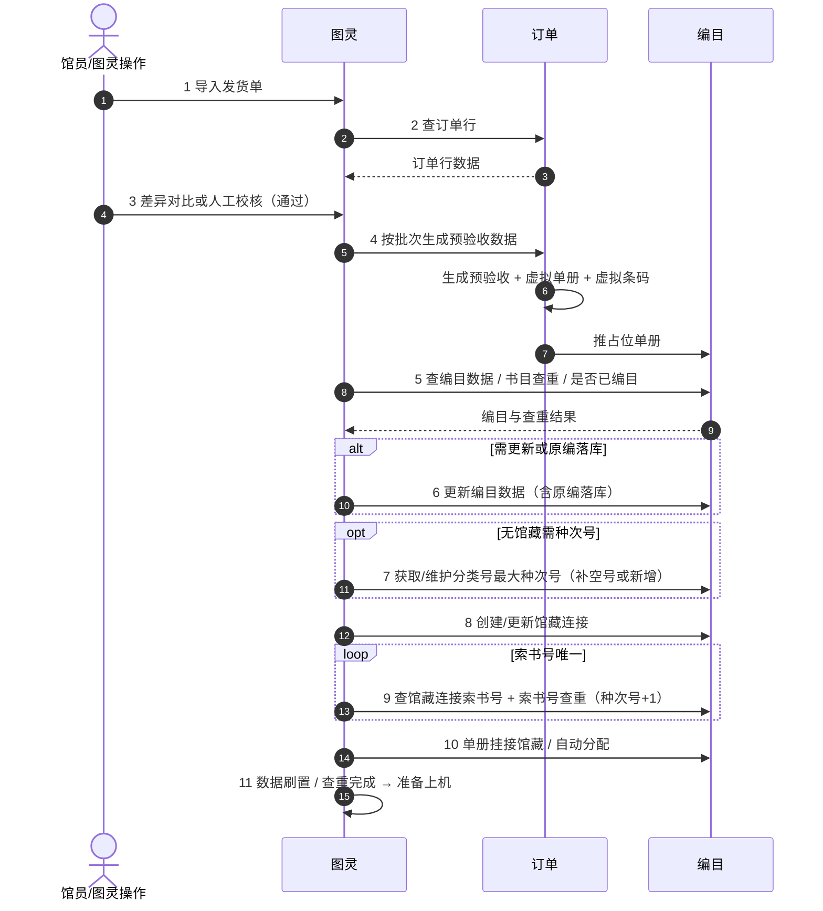
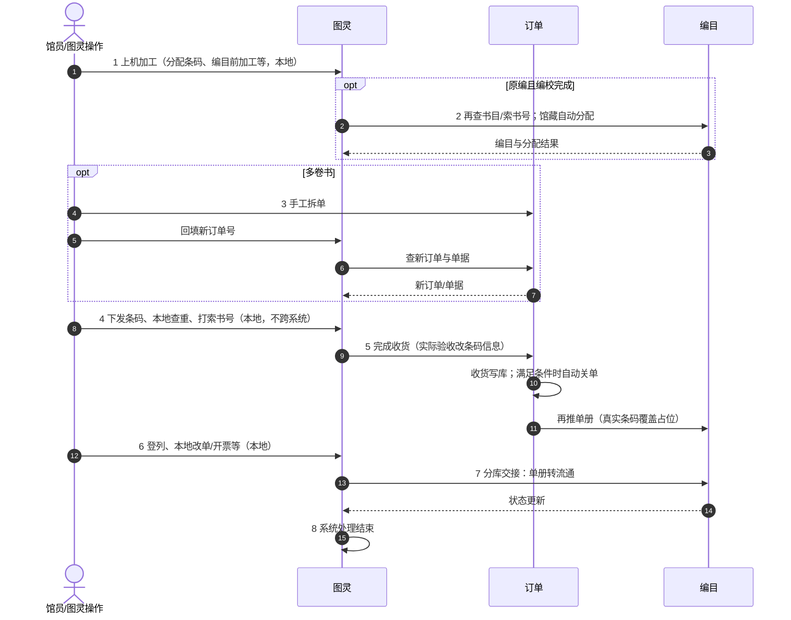

# 图灵 · 订单 · 编目：预验收 / 实际验收三系统交互流程

**日期**：2026-10-14  
**状态**：已确认（头脑风暴定稿，待规格审阅）  
**范围**：三个系统在「预验收」「实际验收」全链路中的主责、数据方向与同步点梳理  
**关联**：
- 订单系统现有预验收 / 逐条收货：`docs/prd.md`（5.7、5.8）、`2026-08-06-pre-accept-draft-receive-autofill-design.md`
- 图灵系统预验收 / 实际验收业务流程图（业务方提供）
- 本期**不**定义接口字段级契约（可另开专题）

---

## 1. 背景与目标

### 1.1 背景

订单系统与编目系统需与图灵系统对接。图灵侧已有预验收（加工准备）与实际验收（上机到转流通）流程；其中若干步骤需与订单、编目同步数据。订单侧现有「预验收」侧重发货单差异核对与草稿，与图灵「预验收」不是同一环节。

### 1.2 目标

1. 用**双泳道图**（预验收 / 实际验收）标清图灵、订单、编目三列主责与数据方向。
2. 给出**同步点清单**，作为后续接口设计与联调的索引。
3. 明确图灵本地步骤、订单自动关单、日志不回写等边界，避免误做成跨系统接口。

### 1.3 非目标

- 不落 API 路径、请求/响应字段、错误码。
- 不改订单侧现有预验收向导 / 逐条收货前端实现（对接实现另开计划）。
- 不展开图灵纯本地 UI 细节（上机加工、打索书号、本地开票等仅作阶段占位）。

---

## 2. 方案

**采用**：双泳道图 + 同步点表（方案 1）。

| 方案 | 说明 | 结论 |
|------|------|------|
| 1 | 预验收 / 实际验收各一张三列泳道 + 同步点清单 | **采用** |
| 2 | 一张端到端大泳道 | 否决（节点过多、分支难摆） |
| 3 | 总览 + 按点拆序列图 | 否决（本期偏碎；接口期可再拆） |

---

## 3. 系统角色与阶段边界

| 系统 | 角色 |
|------|------|
| **图灵** | 全流程调度方：导入发货单、差异/人工校核、编目加工编排、上机加工、实际验收触发收货、分库交接转流通 |
| **订单** | 订单 / 订单行 / 验收业务账：提供订单行查询、按批次生成预验收数据、生成虚拟单册与虚拟条码、完成收货写库、向编目推送单册；多卷由馆员在订单侧手工拆单；关单由订单自动完成 |
| **编目** | 书目 / 馆藏连接 / 索书号与种次号 / 单册权威库：承接图灵查询与更新，接收订单推送的虚拟单册与验收后更新；查单册走编目 |

### 3.1 两阶段

1. **预验收（加工准备）**：导入发货单 → 查订单行 → 差异/人工校核 → 生成预验收与虚拟单册 → 编目查重与更新、种次号、馆藏连接、索书号、挂接 → 准备上机。
2. **实际验收（上机到流通）**：上机加工 →（原编 / 多卷分支）→ 本地条码与打号 → 调订单完成收货并再推单册 → 本地登列/开票等 → 转流通。

### 3.2 已确认约定

1. 图灵也做订单差异核对；**校核通过后**才调订单按批次生成预验收数据。
2. 图灵实际验收直接调订单完成收货，**不必**再走订单侧逐条收货确认。
3. 单册推编目分两步：预验收推**虚拟单册 / 虚拟条码**占位；实际验收收货后再推，用真实条码等覆盖。
4. 多卷书：馆员先在**订单系统手工拆单**，再将新订单号回填图灵后继续。
5. 订购日志、单册修改历史等**不回写**订单作为同步点。
6. 实际验收中的条码下发/查重/打索书号，以及登列、本地改单、创建发票等为**图灵本地**。
7. **关闭订单**由订单在收货后按业务规则**自动**处理，图灵**不**单独调关单接口。

---

## 4. 预验收泳道

图灵单机中间 UI 从略；下列为跨系统步骤。

| 步骤 | 图灵 | 订单 | 编目 |
|------|------|------|------|
| 1 | 导入发货单 | — | — |
| 2 | 发起查订单行 | 返回订单行 | — |
| 3 | 差异对比或人工校核 | — | — |
| 4 | 按批次请求生成预验收 | 生成预验收、虚拟单册/条码；推占位单册到编目 | 接收虚拟单册 |
| 5 | 查编目 / 书目查重 | — | 返回结果 |
| 6 | 更新编目（原编分支） | — | 更新/原编落库 |
| 7 | 分类号最大种次号 | — | 返回/维护种次号 |
| 8 | 创建/更新馆藏连接 | — | 落库 |
| 9 | 查馆藏连接索书号 + 查重循环 | — | 返回索书号/查重 |
| 10 | 单册挂接 / 馆藏分配 | — | 挂接落库 |
| 11 | 准备上机 | — | — |

---

## 5. 实际验收泳道

| 步骤 | 图灵 | 订单 | 编目 |
|------|------|------|------|
| 1 | 上机加工（本地） | — | — |
| 2 | 原编分支：再查书目/索书号、馆藏分配 | — | 返回并落库 |
| 3 | 多卷：回填后查新订单 | 馆员手工拆单；返回新单 | — |
| 4 | 条码下发/查重/打索书号（本地） | — | — |
| 5 | 实际验收 → 完成收货 | 收货写库；**自动关单**；再推单册到编目 | 接收单册更新 |
| 6 | 登列、本地改单/开票（本地） | — | — |
| 7 | 分库交接 → 转流通 | — | 单册状态转流通 |
| 8 | 结束 | — | — |

---

## 6. 同步点清单

| # | 阶段 | 同步点 | 方向 | 主责 | 说明 |
|---|------|--------|------|------|------|
| P1 | 预验收 | 查订单行 | 图灵 → 订单 | 图灵发起 | 供差异对比 |
| P2 | 预验收 | 按批次生成预验收数据 | 图灵 → 订单 | 图灵发起 / 订单落库 | 校核通过后；含虚拟单册 + 虚拟条码 |
| P3 | 预验收 | 推占位单册 | 订单 → 编目 | 订单发起 | 虚拟单册待实际验收更新 |
| P4 | 预验收 | 查编目 / 书目查重 / 是否已编目 | 图灵 → 编目 | 图灵发起 | — |
| P5 | 预验收 | 更新编目（含原编落库） | 图灵 → 编目 | 图灵发起 | — |
| P6 | 预验收 | 分类号最大种次号 | 图灵 → 编目 | 图灵发起 | 补空号或新增最大种次号 |
| P7 | 预验收 | 馆藏连接创建/更新 | 图灵 → 编目 | 图灵发起 | — |
| P8 | 预验收 | 查馆藏连接索书号 + 索书号查重 | 图灵 → 编目 | 图灵发起 | 种次号 +1 直至唯一 |
| P9 | 预验收 | 单册挂接馆藏 / 自动分配 | 图灵 → 编目 | 图灵发起 | 单一/多馆藏 |
| A1 | 实际验收 | 原编后再查书目/索书号、馆藏分配 | 图灵 → 编目 | 图灵发起 | 仅原编分支 |
| A2 | 实际验收 | 多卷拆单后查新订单/单据 | 人工订单 → 图灵 → 订单 | 馆员拆单 / 图灵查询 | 新订单号回填图灵 |
| A3 | 实际验收 | 完成收货 | 图灵 → 订单 | 图灵发起 / 订单落库 | 等价逐条收货；关单自动、无单独关单接口 |
| A4 | 实际验收 | 再推单册 | 订单 → 编目 | 订单发起 | 真实条码覆盖虚拟占位 |
| A5 | 实际验收 | 转流通 | 图灵 → 编目 | 图灵发起 | 分库交接后 |

### 6.1 明确不在同步点内

- 图灵：差异/人工校核、上机加工、实际验收步骤 4（条码与打号）、步骤 6（登列/本地改单/开票）。
- 订购日志、单册修改历史等：不回写订单。
- 关闭订单：订单自动，非图灵调用。

---

## 7. 与订单现有能力的关系

| 订单现有能力 | 对接后关系（本期流程结论） |
|--------------|---------------------------|
| 预验收向导（上传→映射→解析→草稿） | 图灵路径下由「图灵校核通过 → 调订单按批次生成预验收」承接数据写入；是否保留订单侧独立预验收入口不在本期流程范围 |
| 逐条收货确认 | 图灵实际验收调订单完成收货后，馆员**不必**再在订单侧点收货 |
| 条码规则 / 预览 | 图灵路径下条码分配与查重以图灵本地为主；订单生成**虚拟条码**供占位推编目 |
| 查 MARC / 单件（只读编目） | 查单册权威仍在编目；订单单册需推送到编目（P3 / A4） |

---

## 8. 后续工作（非本期）

1. 按同步点 P1–P9、A1–A5 拆接口契约（字段、幂等、批次、失败重试）。
2. 明确订单「自动关单」触发条件与图灵收货回写字段对齐。
3. 多卷手工拆单的操作规范与图灵回填校验。
4. 若需实现联调原型或订单侧改造，另开 implementation plan。

---

## 9. 决策记录

| 决策 | 结论 |
|------|------|
| 交付形态 | 双泳道 + 同步点表 |
| 调度方 | 图灵主导调用订单与编目 |
| 预验收数据写入 | 图灵校核通过后按批次调订单生成 |
| 虚拟单册 | 订单在生成预验收时创建虚拟单册+虚拟条码并推编目 |
| 实际收货 | 图灵调订单完成收货 |
| 单册再推 | 收货后再推编目覆盖占位 |
| 多卷 | 订单手工拆单 + 回填图灵 |
| 日志 | 不回写订单 |
| 关单 | 订单自动，无图灵关单接口 |
| 实际验收步骤 4、6 | 图灵本地 |
