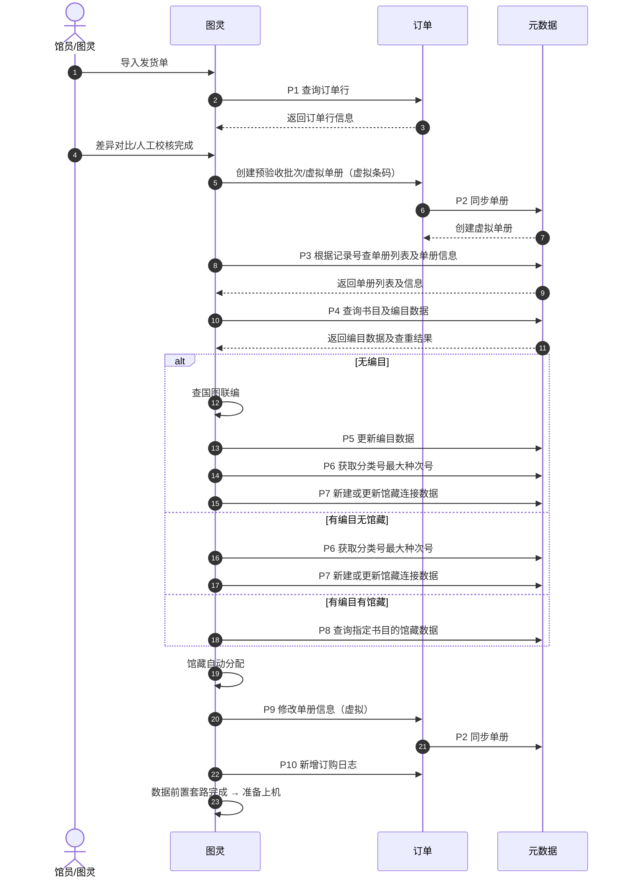
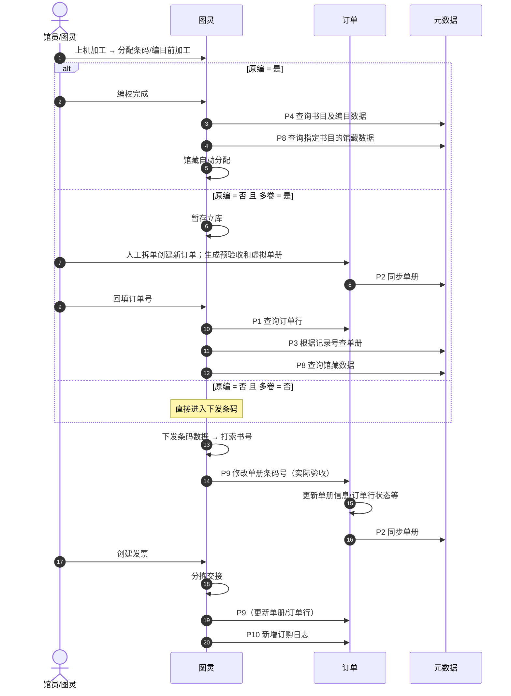

# 图灵 · 订单 · 元数据：预验收 / 上机加工三系统交互流程

**日期**：2026-10-14  
**状态**：已确认（对齐业务方 drawio 流程图）  
**范围**：图灵、订单、元数据在「预验收」「上机加工」全链路中的主责、数据方向与同步点  
**关联**：
- 源流程图：`2026-10-14-turing-order-catalog-acceptance-flow.drawio.xml`（桌面《图灵对接流程图》入库副本）
- 可视化页：`2026-10-14-turing-order-catalog-acceptance-flow.html`
- 订单侧既有预验收 / 逐条收货：`docs/prd.md`（5.7、5.8）等（对接实现另开计划）
- 本期**不**定义接口字段级契约

---

## 1. 背景与目标

### 1.1 背景

订单与元数据需与图灵对接。业务方已整理泳道图（预验收 | 上机加工），跨系统调用以边上的 **P1–P10** 标注为准；同一 Pn 可在两阶段复用。

### 1.2 目标

1. 双泳道（预验收 / 上机加工）标清三列主责与数据方向。  
2. 同步点清单与 drawio 边缘标签 **P1–P10** 一一对应。  
3. 明确图灵本地步骤与订单/元数据落库边界。

### 1.3 非目标

- 不落 API 路径、字段、错误码。  
- 不改订单侧现有预验收向导 / 逐条收货前端（实现另开计划）。  
- 不展开图灵纯本地 UI（分配条码、打索书号、创建发票等仅作阶段占位）。

---

## 2. 方案

**采用**：双泳道 + 统一 Pn 同步点表（与 drawio 一致）。

| 说明 | 结论 |
|------|------|
| 第三系统命名 | **元数据**（原讨论中的「编目」在流程图中统一为元数据） |
| 同步点编号 | 预验收与上机加工**共用** P1–P10，不再使用 A 系列 |
| 交付 | 设计 md + HTML + drawio 源文件 |

---

## 3. 系统角色与阶段边界

| 系统 | 角色 |
|------|------|
| **图灵** | 流程调度：导入发货单、差异/人工校核、编目与馆藏加工编排、上机加工、实际验收改条码、分拣交接等 |
| **订单** | 订单行 / 预验收批次 / 虚拟与真实单册业务账：查询订单行、创建预验收批次与虚拟单册、更新单册与订单行状态、订购/单册日志；多卷人工拆单 |
| **元数据** | 书目编目、馆藏连接、种次号/索书号、单册权威库：承接查询与更新，接收订单同步的虚拟/真实单册 |

### 3.1 两阶段

1. **预验收**：导入发货单 → 查订单行 → 校核 → 创建预验收批次/虚拟单册并同步元数据 → 查单册/书目 → 按有无编目馆藏分支加工 → 馆藏分配 → 改单册并再同步 → 订购日志 → 准备上机。  
2. **上机加工**：分配条码 →（原编 / 多卷分支）→ 下发条码、打索书号 → 修改单册条码（实际验收）并同步元数据 → 创建发票 → 分拣交接（再触达订单更新/日志）。

### 3.2 已确认约定（对齐 drawio）

1. 校核通过后，订单**创建预验收批次 / 虚拟单册（虚拟条码）**，再经 **P2** 同步到元数据。  
2. **P9 修改单册信息** 在预验收（虚拟单册更新）与上机加工（实际验收改条码、分拣交接）均可调用。  
3. **P2 同步单册** 在创建/更新订单侧单册后，由订单推送到元数据（可多次）。  
4. **P10 新增订购日志**：图灵 → 订单（预验收馆藏分配后、上机分拣交接后均可）。  
5. 多卷：订单侧**人工拆单**并生成预验收与虚拟单册，再 P2 同步；图灵**回填订单号**后 P1/P3 查询。  
6. 无编目：图灵侧走**查国图联编**，再 **P5 更新编目数据**（原编落库细节以业务为准；流程图将 P5 标在该路径）。  
7. 关闭订单等订单内部自动规则：流程图未单独标 Pn；若仍由订单在实际验收写库后自动关单，实现期对齐字段即可。

---

## 4. 预验收泳道

| 步骤 | 图灵 | 订单 | 元数据 |
|------|------|------|--------|
| 1 | 导入发货单 | — | — |
| 2 | P1 查询订单行 | 返回订单行信息 | — |
| 3 | 差异对比/人工校核完成 | — | — |
| 4 | 触发创建预验收 | 创建预验收批次/虚拟单册 | — |
| 5 | — | P2 同步单册 | 创建虚拟单册 |
| 6 | P3 查单册 | — | 返回单册列表及信息 |
| 7 | P4 查书目及编目 | — | 返回编目及查重结果 |
| 8a | 无编目：查国图联编 → P5 更新编目 → P6 → P7 | — | 更新编目 / 种次号 / 新建或更新馆藏 |
| 8b | 有编目无馆藏：P6 → P7 | — | 种次号 / 馆藏连接 |
| 8c | 有编目有馆藏：P8 查询馆藏 | — | 返回馆藏数据 |
| 9 | 馆藏自动分配 | — | — |
| 10 | P9 修改单册信息 | 更新单册信息（虚拟） | — |
| 11 | — | P2 同步单册 | 更新单册信息 |
| 12 | P10 新增订购日志 | 新订购/单册日志 | — |
| 13 | 准备上机 | — | — |

---

## 5. 上机加工泳道

| 步骤 | 图灵 | 订单 | 元数据 |
|------|------|------|--------|
| 1 | 上机加工；分配条码/编目前加工 | — | — |
| 2a | 原编：编校完成 → P4 → P8 → 馆藏自动分配 | — | 返回书目/馆藏 |
| 2b | 多卷：暂存立库；回填订单号后 P1、P3、P8 | 人工拆单+预验收/虚拟单册；P2 同步 | 更新虚拟单册；返回单册/馆藏 |
| 2c | 非原编非多卷：直达下发条码 | — | — |
| 3 | 下发条码；打索书号 | — | — |
| 4 | P9 修改单册条码号（实际验收） | 更新单册信息/订单行状态等 | — |
| 5 | — | P2 同步单册 | 更新单册信息 |
| 6 | 创建发票（本地） | — | — |
| 7 | 分拣交接 → P9、P10 | 更新单册/订单行；新订购/单册日志 | （若再同步则仍走 P2） |

---

## 6. 同步点清单（P1–P10）

| # | 同步点 | 方向 | 出现阶段 | 说明 |
|---|--------|------|----------|------|
| P1 | 查询订单行 | 图灵 → 订单 | 预验收；上机（多卷回填后） | 返回订单行信息 |
| P2 | 同步单册 | 订单 → 元数据 | 预验收创建虚拟单册后；预验收 P9 后；上机多卷拆单后；上机实际验收/分拣后 | 创建或更新元数据侧单册 |
| P3 | 根据记录号查单册列表及单册信息 | 图灵 → 元数据 | 预验收；上机（查新订单和单册时） | — |
| P4 | 查询书目及编目数据 | 图灵 → 元数据 | 预验收；上机原编编校后 | 含书目查重语义 |
| P5 | 更新编目数据 | 图灵 → 元数据 | 预验收（无编目路径，含查国图联编后） | — |
| P6 | 获取分类号最大种次号 | 图灵 → 元数据 | 预验收（无编目或有编目无馆藏） | — |
| P7 | 新建或更新馆藏连接数据 | 图灵 → 元数据 | 预验收（创建馆藏连接） | — |
| P8 | 查询指定书目的馆藏数据 | 图灵 → 元数据 | 预验收（有编目有馆藏）；上机原编/多卷/查询馆藏 | 含索书号查重场景下的查询 |
| P9 | 修改单册信息 | 图灵 → 订单 | 预验收（虚拟）；上机实际验收改条码；分拣交接 | 订单落库后再视需要 P2 |
| P10 | 新增订购日志 | 图灵 → 订单 | 预验收馆藏分配后；上机分拣交接后 | 订单侧新订购/单册日志 |

### 6.1 明确不在独立 Pn 内（图灵本地或订单内部）

- 导入发货单、差异对比/人工校核、馆藏自动分配编排、数据前置套路完成、准备上机。  
- 上机：分配条码/编目前加工、编校完成、暂存立库、回填订单号、下发条码、打索书号、创建发票。  
- 订单：人工拆单创建新订单、创建预验收批次本身（紧接 P2）；自动关单若存在则无单独 Pn。

---

## 7. 与订单现有能力的关系

| 订单现有能力 | 对接后关系 |
|--------------|------------|
| 预验收向导 | 图灵路径下由校核后「创建预验收批次/虚拟单册」+ P2 承接；是否保留订单侧独立入口不在本期 |
| 逐条收货确认 | 上机「修改单册条码号（实际验收）」走 P9 后，馆员不必再在订单侧点收货 |
| 查 MARC/单件 | 权威在元数据；查单册为 P3；订单单册经 P2 同步 |

---

## 8. 后续工作（非本期）

1. 按 P1–P10 拆接口契约（字段、幂等、批次、失败重试）。  
2. 对齐「自动关单」与 P9 实际验收写库字段。  
3. 多卷人工拆单与回填订单号操作规范。  
4. 实现联调或订单侧改造时另开 implementation plan。

---

## 9. 决策记录 / 相对前一版变更

| 项 | 结论 |
|----|------|
| 第三系统 | **元数据**（不再称编目泳道） |
| 编号 | 统一 **P1–P10**，取消 A 系列 |
| P2 | **同步单册**（订单 → 元数据），可多处复用 |
| P9 | **修改单册信息**（图灵 → 订单），含实际验收改条码 |
| P10 | **新增订购日志**（图灵 → 订单）恢复为同步点 |
| 预验收分支 | 无编目 / 有编目无馆藏 / 有编目有馆藏 三分支对齐 drawio |
| 源文件 | 以 drawio 为准；本文与 HTML 为可读副本 |
